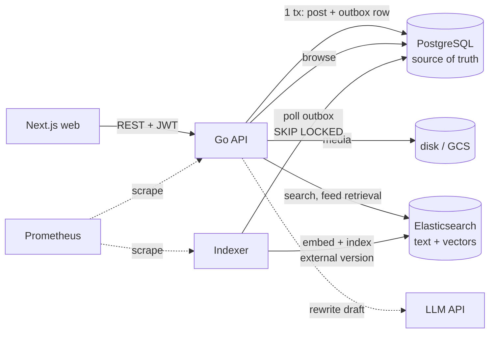

# NetworkAI

[](https://github.com/polo2444172276/networkai/actions/workflows/ci.yml)

A social posting and discovery app, with a Go backend and a Next.js
frontend. Users post text, images and video, browse a chronological feed,
get a personalised "For you" feed, search, like posts, and can ask an LLM to
polish a draft.

The engineering focus is the data path and how it behaves under failure and
load:
- **PostgreSQL is the source of truth.** Elasticsearch is a derived index
  kept in sync by a **transactional outbox**, so a search outage loses no
  writes.
- **The personalised feed** is a two-stage recommender: kNN retrieval on
  post embeddings, then a learned ranker, evaluated offline with nDCG@10.
- Every claim below has a test, a script, or a measured number behind it.




## Key numbers

| | Result | Evidence |
|---|---|---|
| Search outage | 150 s outage: **0 writes lost, 0 events dead-lettered**; alert fired at ~270 s and resolved after recovery | [engineering log](docs/engineering-log.md), `TestElasticsearchOutageLosesNoWrites` |
| Throughput (one 4-vCPU VM, load generator included) | ~1,200 req/s mixed traffic, **0% errors on core endpoints**, search P95 67 ms | [benchmark](docs/benchmark.md) |
| Feed overload fix | at 1000 req/s: search P50 **4.4 s → 20 ms**, ES rejections 51k → 0 | [benchmark](docs/benchmark.md#beforeafter-the-feed-starving-search) |
| Full reindex, 100k posts | **134 s → 4.7 s** (`_bulk`, A/B on the same data) | [engineering log](docs/engineering-log.md) |
| Feed ranking (offline, **synthetic data**) | nDCG@10 **+14.0%** vs chronological on 300k held-out impressions | [ranking eval](docs/ranking-eval.md), [why synthetic](docs/ranking.md#the-data-is-synthetic-and-this-is-what-that-means) |
| Tests | Go: unit + integration + e2e with the race detector (74% coverage); Playwright: 8 UI flows; CI runs all of it | [CI](.github/workflows/ci.yml) |

## Quick start

Requires Docker, plus `curl` and `jq` for the scripts. k6 is needed for the
load test.

```bash
make up             # postgres, elasticsearch, api (:8080), indexer
make seed           # a few demo users and posts
make demo-outage    # stop Elasticsearch, keep posting, recover, lose nothing
cd web && npm ci && npm run dev    # http://localhost:3000

# Optional: 100k synthetic posts, embeddings, trained ranker, load test
make synth train load-synth
RATE=500 make loadtest
docker compose --profile observability up -d   # Prometheus on :9090
```

## API

| Method | Path | Auth | Notes |
|---|---|---|---|
| `POST` | `/users`, `/auth/login` | – | bcrypt; JWT (HS256, pinned) |
| `POST` | `/posts` | JWT | JSON `{"message"}` or multipart with `media_file` (type sniffed) |
| `GET` | `/posts?author=&cursor=` | optional | chronological, from PostgreSQL, keyset pagination |
| `GET` | `/posts/search?q=&author=&type=&cursor=` | optional | Elasticsearch, `search_after` pagination |
| `GET` / `PATCH` / `DELETE` | `/posts/{id}` | owner for writes | soft delete |
| `POST` / `DELETE` | `/posts/{id}/like` | JWT | idempotent |
| `GET` | `/feed` | JWT | personalised; each item explains its score, features and sources |
| `POST` | `/assist/rewrite` | JWT | `{"mode": "polish\|shorten\|hashtags", "draft"}` |
| `GET` | `/healthz`, `/readyz`, `/metrics` | – | `/readyz` includes outbox lag |

Errors always look like `{"error":{"code","message"},"request_id"}`.

## Design decisions

| ADR | Decision |
|---|---|
| [0001](docs/adr/0001-postgres-source-of-truth-with-outbox.md) | PostgreSQL as source of truth; transactional outbox instead of dual writes or CDC |
| [0002](docs/adr/0002-idempotent-order-independent-indexing.md) | Events carry ids; indexer re-reads the row; external versions + tombstones make replays and reordering harmless |
| [0003](docs/adr/0003-pause-worker-on-dependency-outage.md) | A dependency outage pauses the worker instead of burning per-event retries (bug found in the outage demo) |
| [0004](docs/adr/0004-llm-writing-assistant.md) | The LLM is an unreliable, metered dependency: timeout, one retry, per-user limit, token/cost accounting, injection mitigation, graceful fallback |
| [ranking.md](docs/ranking.md) | Two-stage feed: kNN retrieval → logistic-regression ranker → author diversity; bulkhead so the feed cannot starve search |

## Documentation

- [benchmark.md](docs/benchmark.md): load-test method, results, before/after, caveats
- [engineering-log.md](docs/engineering-log.md): every real bug and bottleneck, how it was found, fixed and verified
- [bottlenecks.md](docs/bottlenecks.md): open environment blockers and remaining limits (Chinese)
- [runbook.md](docs/runbook.md): what to do when each alert fires
- [ranking.md](docs/ranking.md) / [ranking-eval.md](docs/ranking-eval.md): feed design and generated offline evaluation
- [docs/learn/](docs/learn/README.md): study notes and an interview question bank (Chinese)

## Testing

```bash
make test               # Go unit tests (integration tests skip without databases)
make test-integration   # + PostgreSQL / Elasticsearch integration and e2e tests
make web-test           # frontend lint, typecheck, build, Playwright
```

Key properties are checked by tests that were **mutation-checked**: we
deliberately broke the code and confirmed the test fails. The broken
versions were:
- no external versioning;
- no outbox insert;
- no `SKIP LOCKED`;
- no outage pause;
- no rebuild catch-up;
- a TF formula that drifts from the Python trainer.

## Known limitations

- **The feed is the most expensive endpoint by ~10x.** With 2 concurrent
  slots it serves ~22 req/s under mixed load on this VM and sheds the rest
  (the UI falls back to Latest). Next steps:
  - cache each user's candidates;
  - precompute feeds for active users;
  - isolate vector search on its own Elasticsearch capacity.
- **The ranking evaluation uses synthetic data.** No public dataset was
  reachable from the build environment. The pipeline accepts a real one
  unchanged.
- **The LLM assistant's real latency and cost are unmeasured.** No provider
  was reachable from the build environment; the instrumentation is in
  place.
- **Single region and a single PostgreSQL primary.** The polling outbox
  adds ~0.5 s of search lag. Orphaned media and tombstones are cleaned by
  periodic jobs.
- **Benchmarks ran with the load generator on the same 4 vCPUs** as the
  services.

## Project history

The first two commits are the original prototype: Go, Elasticsearch as the
only datastore, plaintext passwords, and public-ACL GCS objects. Everything
after them rebuilds it. Each commit message explains what was wrong and why
it changed.

## Layout

```
cmd/networkai/        api | indexer | migrate | reindex [-fresh] | sweep-media
internal/httpapi/     routing, middleware, handlers, error mapping
internal/store/       PostgreSQL; every post write also writes the outbox
internal/outbox/      outbox worker: claiming, retries, dead-letter, pause
internal/indexer/     events -> Elasticsearch, bulk reindex, blue/green rebuild
internal/search/      Elasticsearch client: mapping, analyzers, search, kNN
internal/feed/        two-stage personalised feed + bulkhead
internal/embed/       LSA embeddings (parity-tested against the trainer)
internal/assist/      LLM writing assistant
internal/metrics/     Prometheus metrics
internal/auth, media, maintenance, db, e2e
web/                  Next.js frontend + Playwright tests
tools/                synthetic data, ranking trainer/evaluator, k6 load test
models/               trained embedding + ranker (small JSON files)
deploy/prometheus/    scrape config and alert rules
```
