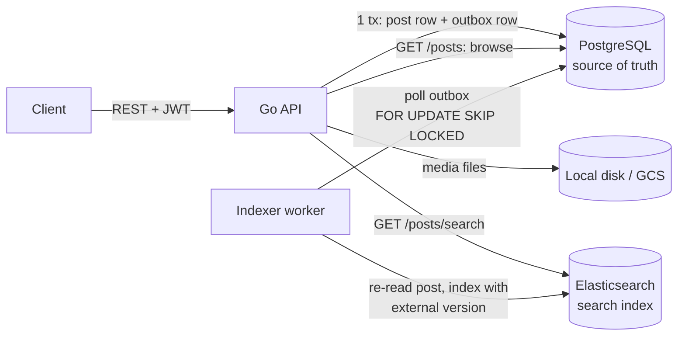

# NetworkAI

[](https://github.com/polo2444172276/networkai/actions/workflows/ci.yml)

Backend for a social posting and discovery app, written in Go. Users post text,
images and video, browse a chronological feed, and run full-text search.

The interesting part is the data path. **PostgreSQL is the source of truth**,
and Elasticsearch is a derived search index kept in sync by a
**transactional outbox**. The service keeps accepting posts during a search
outage and loses nothing when search comes back.



## Quick start

Requires Docker, plus `curl` and `jq` for the scripts.

```bash
make up            # postgres, elasticsearch, api (:8080), indexer
make seed          # demo users and posts, then a couple of searches
make demo-outage   # stop Elasticsearch, keep posting, recover, lose nothing
make test-integration
```

<details>
<summary>What <code>make demo-outage</code> prints (recorded run)</summary>

```text
1. Stopping Elasticsearch
2. Posting 5 times while search is down
  created 6a05f26d-85ed-4a5a-ac22-f72d37220031
  ...
3. Browsing still works (served from PostgreSQL):
  Outage post 5 about kayaking
4. Search degrades to a clean 503 instead of a crash:
{"error":{"code":"search_unavailable","message":"search is temporarily unavailable; browsing and posting still work"},"request_id":"bcbd82bb754b8450"}
5. Outbox backlog (events waiting to be indexed):
{ "pending": 5, "dead": 0, "oldest_pending_seconds": 0.055 }
6. Starting Elasticsearch again
7. All posts written during the outage are searchable:
  Outage post 5 about kayaking
  ... (all 5)
{ "pending": 0, "dead": 0, "oldest_pending_seconds": 0 }
```
</details>

## API

| Method | Path | Auth | Notes |
|---|---|---|---|
| `POST` | `/users` | – | `{"username","password"}`; bcrypt-hashed |
| `POST` | `/auth/login` | – | returns `{"token","expires_at"}` (JWT, HS256) |
| `POST` | `/posts` | JWT | multipart: `message`, optional `media_file` (type sniffed from content) |
| `GET` | `/posts?author=&limit=&cursor=` | – | chronological, from PostgreSQL, keyset pagination |
| `GET` | `/posts/search?q=&author=&type=&limit=&cursor=` | – | Elasticsearch relevance ranking, `search_after` pagination |
| `GET` | `/posts/{id}` | – | |
| `PATCH` | `/posts/{id}` | owner | `{"message"}` |
| `DELETE` | `/posts/{id}` | owner | soft delete; media file removed |
| `GET` | `/healthz`, `/readyz` | – | `/readyz` includes outbox lag |

Every error has the same shape:
`{"error":{"code":"forbidden","message":"..."},"request_id":"..."}`.

## Design decisions

Each one has a short ADR with the alternatives considered:

- **[0001](docs/adr/0001-postgres-source-of-truth-with-outbox.md)**: PostgreSQL as
  source of truth, synced to Elasticsearch through a transactional outbox
  rather than dual writes or CDC.
- **[0002](docs/adr/0002-idempotent-order-independent-indexing.md)**: idempotent,
  order-independent indexing. Events carry only an id, the indexer re-reads
  the current row and writes with Elasticsearch external versioning, and
  deletes are version-carrying tombstones.
- **[0003](docs/adr/0003-pause-worker-on-dependency-outage.md)**: an unavailable
  dependency pauses the worker instead of spending per-event retries. This
  fixes a bug found during the outage demo.

Smaller choices are documented in code comments next to where they apply:
- keyset pagination instead of `OFFSET`;
- timing-safe login, so usernames can't be discovered by timing;
- JWT algorithm pinning;
- upload content sniffing;
- compensating deletes for orphaned uploads;
- `/readyz` deliberately not depending on Elasticsearch.

## Testing

```bash
make test               # unit tests; integration tests skip without databases
make test-integration   # everything, against real PostgreSQL + Elasticsearch
```

Integration tests each get a fresh database and an isolated index, so they run
in parallel. CI runs all of them with the race detector against real service
containers. Some of the properties under test:

| Property | Test |
|---|---|
| A post change and its outbox event commit or roll back together | `TestFailedPostWriteLeavesNoOutboxEvent` |
| An Elasticsearch outage loses no writes, including edits and deletes made during it | `TestElasticsearchOutageLosesNoWrites` |
| Stale, duplicate and out-of-order index writes converge to the latest state | `TestOutOfOrderIndexWritesConverge` |
| A long dependency outage dead-letters nothing | `TestUnavailableDependencyPausesWithoutSpendingRetries` |
| Parallel workers process each event exactly once, and actually in parallel | `TestConcurrentWorkersClaimDisjointEvents` |
| Pagination never skips or repeats items under timestamp ties | `TestListPostsKeysetPagination`, `TestSearchPaginationAndFilters` |
| `alg: none`, expired, tampered and wrong-issuer tokens are rejected | `TestTokenRejections` |

The key tests were checked by **deliberately breaking the code** and confirming
that they fail:
- removing external versioning;
- removing the outbox insert;
- dropping `SKIP LOCKED`;
- disabling the outage pause.

## Known limitations and what would change at scale

- **Single region, single PostgreSQL primary.** Read replicas would serve
  `GET /posts` if browse traffic dominated.
- **Polling outbox.** It is simple and durable, with roughly 0.5 s added
  latency. Options are `LISTEN/NOTIFY` to wake the worker, or Debezium CDC
  if several consumers need the change stream.
- **Tombstones and processed outbox rows accumulate.** Outbox rows are pruned
  after 7 days. Tombstone purging is not implemented yet.
- **Orphaned media is possible** if the process crashes between upload and
  commit. This needs a periodic sweep.
- **Search ranking is BM25 plus a boost for exact wording.** It has no
  personalization yet (see roadmap).
- **Not load-tested yet.** No latency or throughput numbers are claimed until
  there is a reproducible benchmark.

## Roadmap

- [ ] k6 load test with a published methodology (P95 latency, RPS)
- [ ] Prometheus metrics and an alert on outbox lag
- [ ] Next.js frontend
- [ ] Personalized feed: candidate retrieval plus a feature-based ranker, evaluated offline with nDCG@10 against the chronological baseline
- [ ] Tombstone purge and orphaned-media sweep

## Project history

The first two commits are the original prototype: Go, Elasticsearch as the
only datastore, plaintext passwords, and GCS objects with public ACLs. The
commits after them rebuild it into the design above. The commit messages
describe each defect that was fixed and why.

## Layout

```
cmd/networkai/        main: api | indexer | migrate | reindex
internal/httpapi/     routing, middleware, handlers, error mapping
internal/store/       PostgreSQL access; every post write also writes the outbox
internal/outbox/      outbox worker: claiming, retries, dead-letter, pause
internal/indexer/     outbox event -> Elasticsearch document
internal/search/      Elasticsearch client, index mapping and analyzers
internal/auth/        bcrypt, JWT
internal/media/       local disk / GCS storage behind one interface
internal/db/          connection pool and SQL migrations
internal/e2e/         end-to-end tests over HTTP
docs/adr/             architecture decision records
docs/learn/           study notes (Chinese)
```
