# NetworkAI design graphs

Everything needed to understand the system's design: what it is, how it
fits together, how it got here, and how it behaves when things fail.

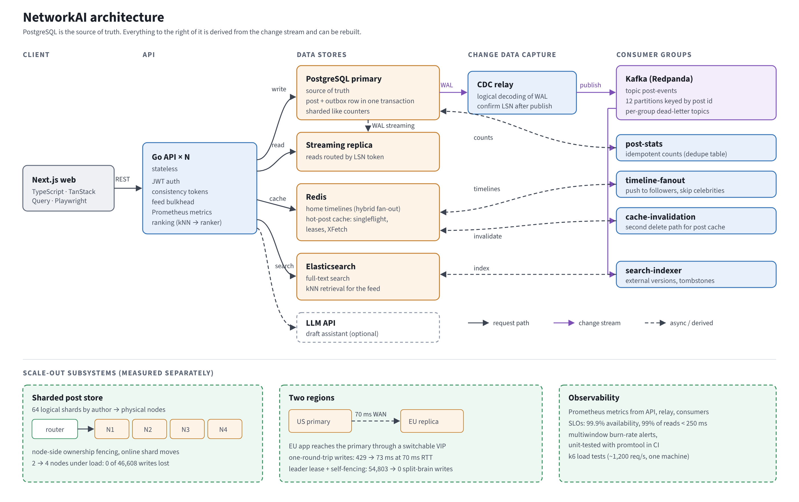

## In one paragraph

NetworkAI is a social posting and discovery platform: posts, follows, a
home timeline, search, likes and a personalized feed. It has a Go backend
and a Next.js frontend.

**PostgreSQL is the only source of truth.** Every change is written
together with an outbox event, streamed from the write-ahead log into
Kafka, and applied by independent, idempotent consumer groups to
Elasticsearch (search), Redis (timelines and caches) and statistics.

The design was grown step by step. Each problem that appears at scale was
reproduced on purpose, fixed, and measured before and after:
- celebrity fan-out;
- coupled background jobs;
- replica lag;
- viral-post hot keys;
- one database's limits;
- distance between regions, and regional failure.

## Contents

| File | What it shows |
|---|---|
| [architecture.png](architecture.png) ([svg](architecture.svg)) | The current system: every component, the request path, the change stream, and the scale-out subsystems |
| [overview.md](overview.md) | High-level description: design principles, components, request flows, results, scope |
| [evolution.md](evolution.md) | **How the design evolved**: 10 steps from the prototype, each with a diagram, the problem, the change, the rationale, the evidence and the cost |
| [flows.md](flows.md) | Sequence diagrams: creating a post, reading the timeline, read-your-writes, the hot-post cache, a shard move, region failover |
| [data-model.md](data-model.md) | Tables and keys in PostgreSQL, Redis, Elasticsearch, Kafka and the sharded store |
| [failure-modes.md](failure-modes.md) | What users notice when each component fails, what protects the system, and how it recovers |

## The evolution at a glance

| | | |
|---|---|---|
| [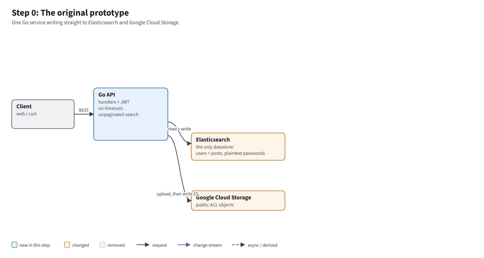](evolution.md#step-0-the-original-prototype) **0. Prototype**: Go + Elasticsearch only | [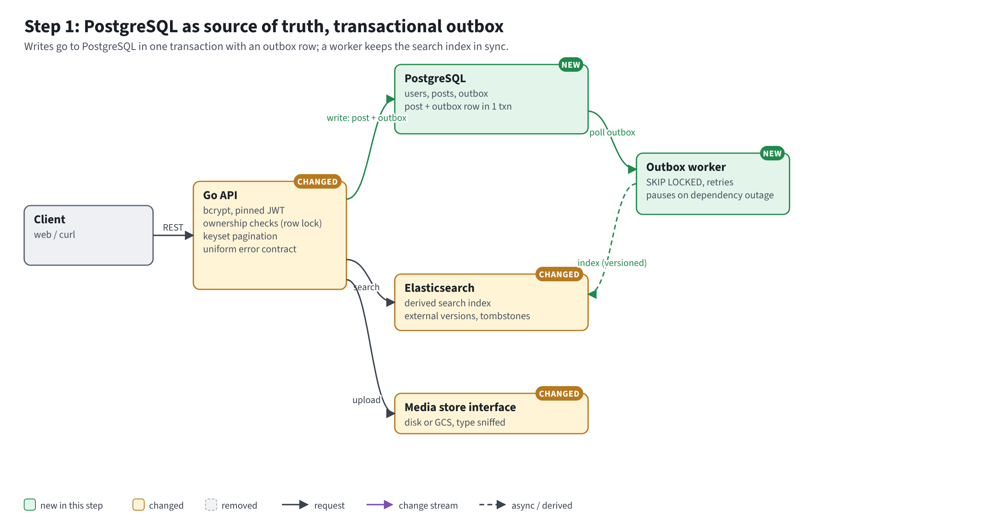](evolution.md#step-1-postgresql-as-source-of-truth-transactional-outbox) **1. PostgreSQL + outbox** | [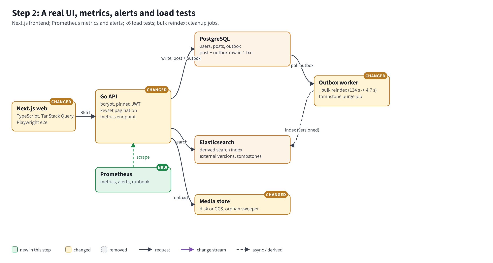](evolution.md#step-2-a-real-ui-metrics-alerts-and-load-tests) **2. UI, metrics, load tests** |
| [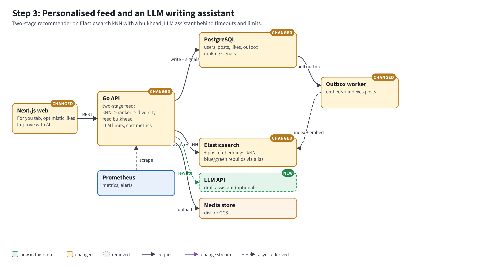](evolution.md#step-3-personalised-feed-and-an-llm-writing-assistant) **3. Personalized feed, LLM** | [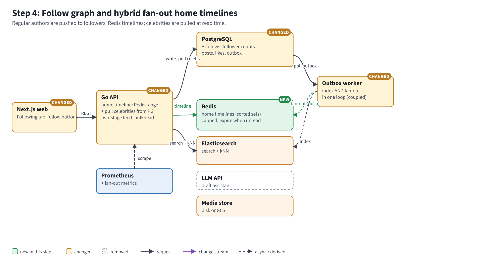](evolution.md#step-4-follow-graph-and-hybrid-fan-out-home-timelines) **4. Hybrid fan-out timelines** | [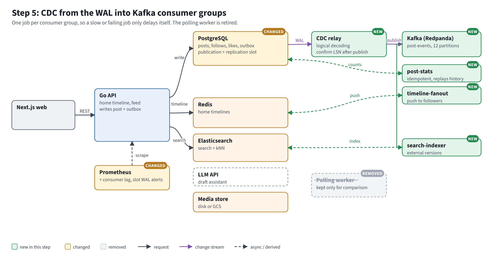](evolution.md#step-5-cdc-from-the-wal-into-kafka-consumer-groups) **5. CDC + Kafka** |
| [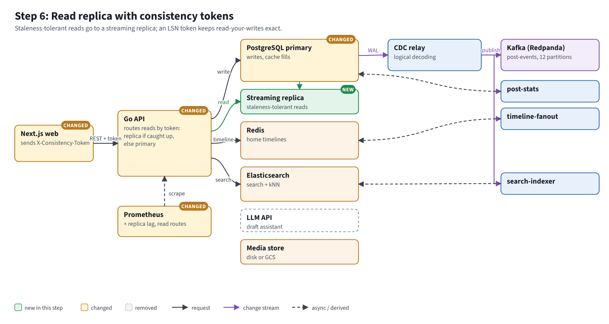](evolution.md#step-6-read-replica-with-consistency-tokens) **6. Replica + consistency tokens** | [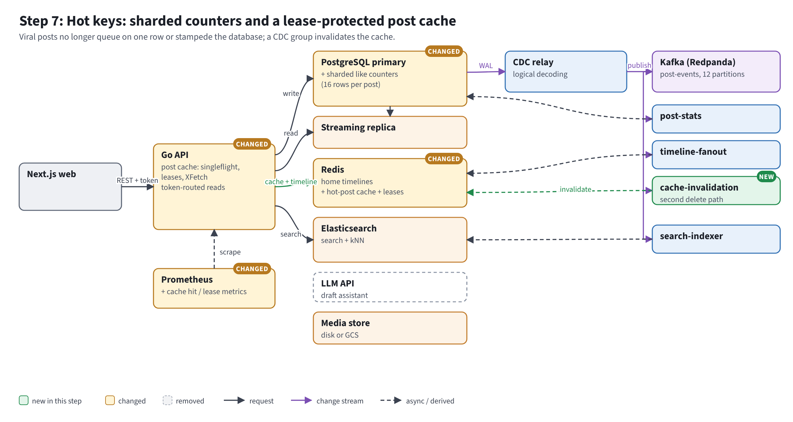](evolution.md#step-7-hot-keys-sharded-counters-and-a-lease-protected-post-cache) **7. Hot keys** | [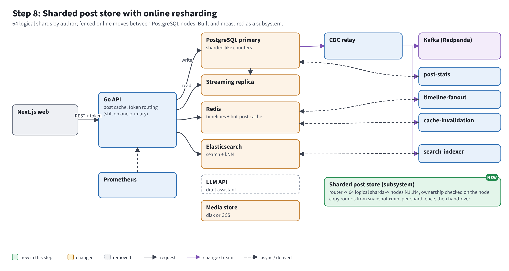](evolution.md#step-8-sharded-post-store-with-online-resharding) **8. Online resharding** |
| [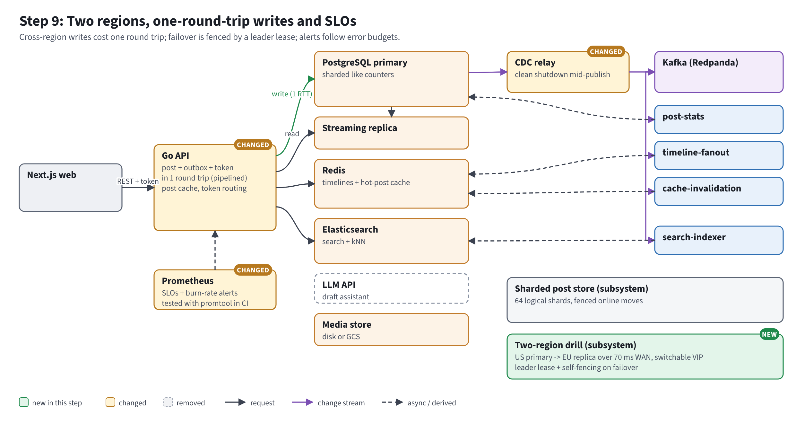](evolution.md#step-9-two-regions-one-round-trip-writes-and-slos) **9. Two regions, SLOs** | | |

## Glossary

| Term | Meaning here |
|---|---|
| **Source of truth** | The one store whose data is authoritative: PostgreSQL. Everything else can be rebuilt from it. |
| **Dual write** | Writing the same change to two systems from one request. A crash between the two leaves them inconsistent. |
| **Transactional outbox** | An event row written in the same transaction as the change, so the change and "someone must propagate it" commit together. |
| **WAL / CDC** | The write-ahead log is PostgreSQL's ordered record of committed changes. Change data capture reads it (logical decoding) to stream changes out. |
| **Consumer group** | A set of Kafka consumers sharing one position in the log. Each downstream job is its own group, so each fails and recovers on its own. |
| **At-least-once + idempotent** | Events may be delivered more than once; applying one twice has the same effect as applying it once. |
| **External version** | Elasticsearch only accepts a document whose version is higher than the stored one, so late or repeated events cannot overwrite newer data. |
| **Fan-out on write / on read** | Push a post into every follower's timeline when it is written, or pull followees' posts when the timeline is read. Hybrid does each where it is cheap. |
| **LSN / consistency token** | Log sequence number: a position in the WAL. Returned after a write, so later reads can wait for, or bypass, a replica that has not reached it. |
| **Read-your-writes** | A user always sees their own writes, even when reads go to a lagging replica. |
| **Hot key** | One key (a viral post) receiving a large share of all traffic. |
| **Cache stampede** | Many readers miss the same key at once and all load it from the database. |
| **Stale set** | A slow reader writing an old value into the cache after a newer write invalidated it. |
| **Singleflight / lease / XFetch** | Merge identical loads within a process; let only one instance load and fill, rejecting stale fills; refresh shortly before expiry. |
| **Logical shard** | One of 64 fixed buckets of data (by author). Buckets move between physical nodes; rows are never rehashed. |
| **Fence** | A step that guarantees an old owner can no longer write, before a new owner starts. A shard move uses a lock; region failover uses a lease. |
| **Split brain** | Two nodes both accepting writes as the primary. |
| **RPO / RTO** | Recovery point objective (how much data can be lost) and recovery time objective (how long until service returns). |
| **SLO / error budget / burn rate** | A reliability target (e.g. 99.9% of requests succeed), the failures it allows, and how fast those are being used up. |

## Regenerating the diagrams

```bash
python3 design-graph/generate.py   # evolution/*.svg from one layout definition
node design-graph/render.js        # every SVG here -> 2x PNG (needs Playwright)
```

`architecture.svg` is edited by hand; the evolution diagrams come from
`generate.py`.
