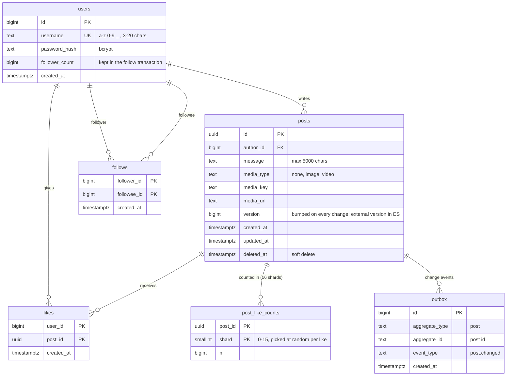
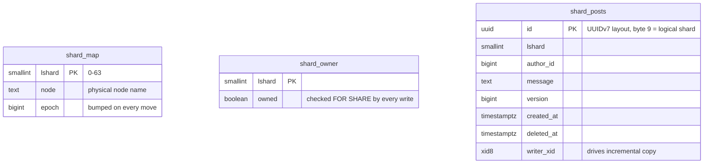

# Data model

## PostgreSQL (source of truth)

Supporting tables:
- `daily_post_counts` and `stats_counted_posts` belong to the `post-stats`
  consumer. The second is its dedupe table, which makes replays safe.
- `schema_migrations` records which migrations have run.
- Outbox rows are deleted once Kafka has them.
- The publication `networkai_outbox` covers outbox inserts only, so the
  relay never sees the deletes.

Key design points:
- **Every post write inserts an outbox row in the same transaction**, so a
  change can never be committed without its event.
- `posts.version` is what makes indexing idempotent and order-independent:
  Elasticsearch only accepts a document with a higher external version.
- Like counts are the sum of up to 16 `post_like_counts` rows. A viral
  post's likes spread over 16 row locks instead of one.

## Derived stores (rebuildable)

| Store | Key | Value | Rebuilt from |
|---|---|---|---|
| Redis | `tl:{user_id}` | sorted set of post ids, scored by time; capped at 800; a marker entry means "built" | followees' posts in PostgreSQL (primary) |
| Redis | `post:{id}` | cached post JSON with its load time and expiry (for XFetch); "not found" cached for 5 s | PostgreSQL primary, on the next miss |
| Redis | `post-lease:{id}` | lease token, 2 s TTL | nothing (transient) |
| Elasticsearch | index behind alias `posts` | message (analysed + exact), author, media type, time, embedding vector | `networkai reindex`, or a blue/green rebuild |
| Kafka | topic `post-events` | `{id, aggregate_type, aggregate_id, event_type, created_at}`, keyed by post id | the outbox via the relay. Consumers re-read PostgreSQL, so events carry ids, not data |

## Sharded post store (subsystem, separate databases)

- `shard_map` lives in the directory database.
- Each node has its own `shard_owner` and `shard_posts`.
- `hash(author_id) % 64` chooses the logical shard; the directory maps it
  to a node.
