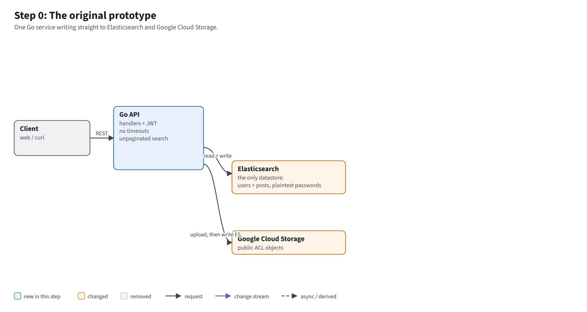
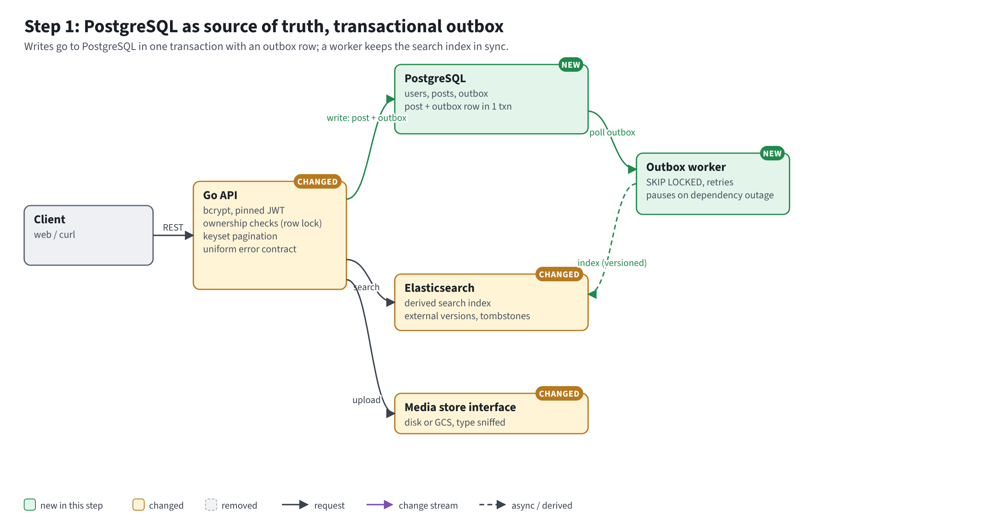
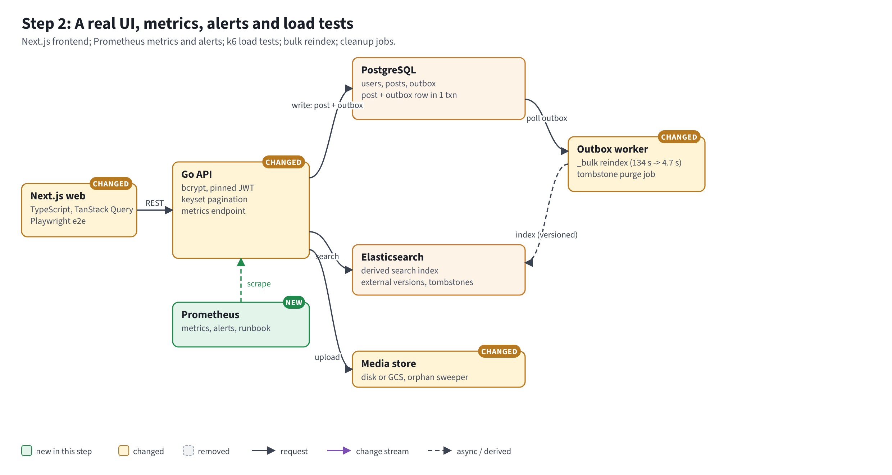
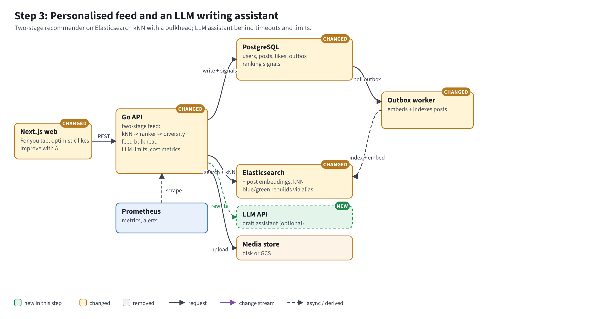
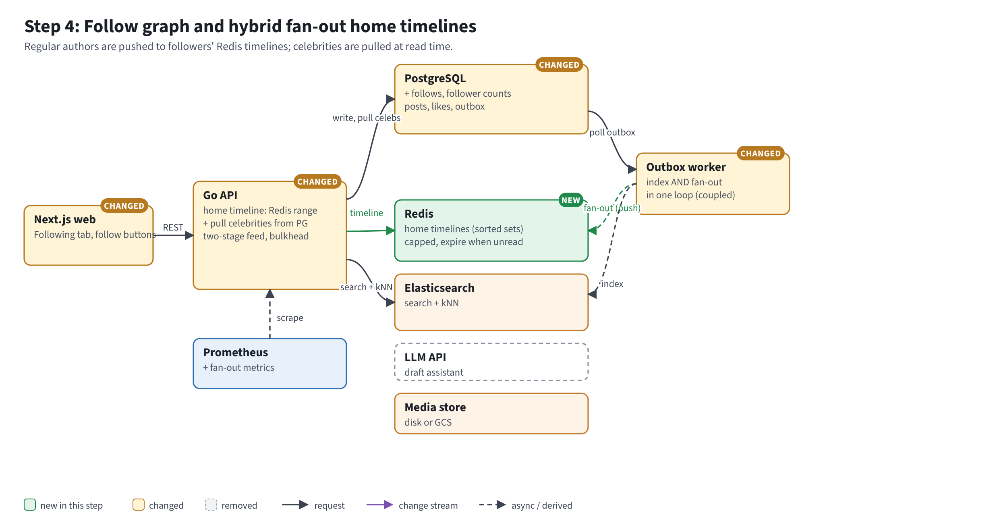
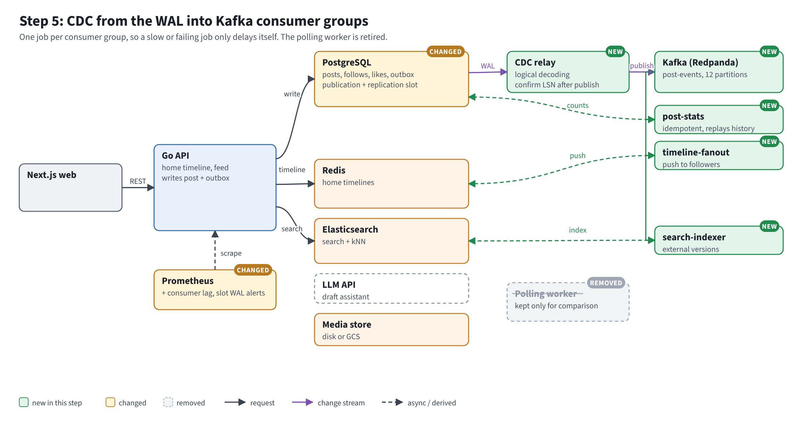
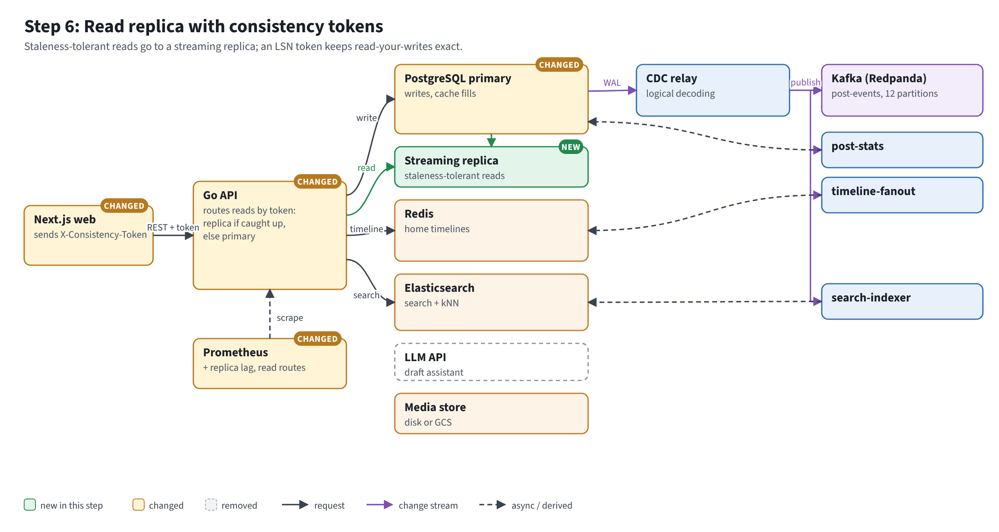
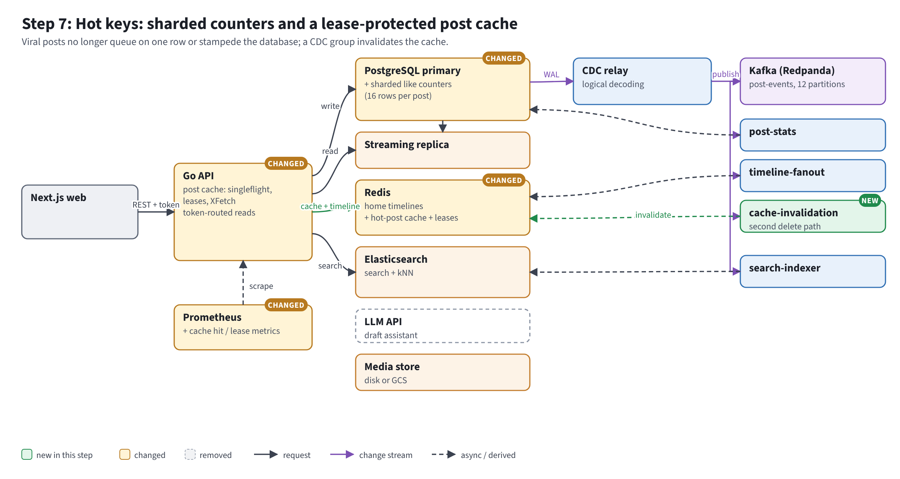
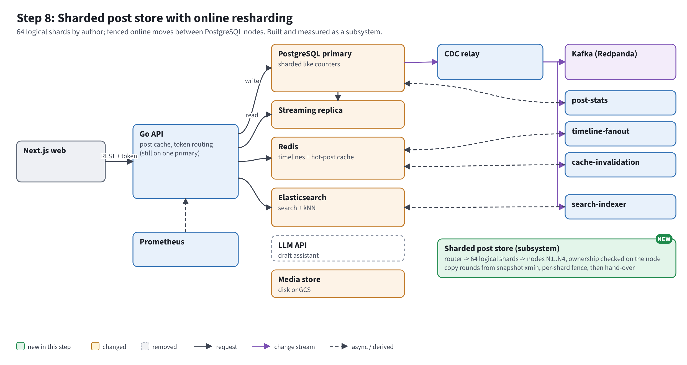
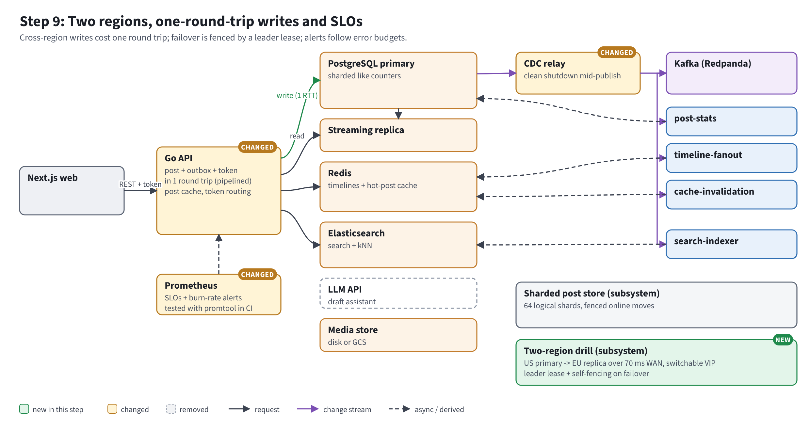

# How the design evolved

Ten steps from the original prototype to the current system. Every
diagram uses the same layout, so components keep their place as the
system grows:
- **green** marks what is new in that step;
- **amber** marks what changed;
- **grey, dashed** marks what was removed.

Each step follows the same order:
1. **problem**: what was wrong, or what would break;
2. **change**: what was built;
3. **why this design**: the reasoning, and the alternatives rejected;
4. **evidence**: the measurement;
5. **cost**: what it made worse or left open.

| Step | Change | Driven by | Decision record |
|---|---|---|---|
| [0](#step-0-the-original-prototype) | Prototype: Go + Elasticsearch only | — | — |
| [1](#step-1-postgresql-as-source-of-truth-transactional-outbox) | PostgreSQL + transactional outbox | data loss, security defects | ADR 0001–0003 |
| [2](#step-2-a-real-ui-metrics-alerts-and-load-tests) | Frontend, metrics, alerts, load tests | "is it working, and how fast?" | — |
| [3](#step-3-personalised-feed-and-an-llm-writing-assistant) | Two-stage feed, LLM assistant | product features, then a load-test collapse | ADR 0004, ranking.md |
| [4](#step-4-follow-graph-and-hybrid-fan-out-home-timelines) | Follows + hybrid fan-out timelines | celebrity fan-out | ADR 0005 |
| [5](#step-5-cdc-from-the-wal-into-kafka-consumer-groups) | CDC + Kafka consumer groups | one job stalling the others | ADR 0006 |
| [6](#step-6-read-replica-with-consistency-tokens) | Read replica + consistency tokens | read load vs read-your-writes | ADR 0007 |
| [7](#step-7-hot-keys-sharded-counters-and-a-lease-protected-post-cache) | Sharded counters, lease-protected cache | viral posts | ADR 0008 |
| [8](#step-8-sharded-post-store-with-online-resharding) | Sharding with online moves | one primary's limits | ADR 0009 |
| [9](#step-9-two-regions-one-round-trip-writes-and-slos) | Two regions, 1-RTT writes, SLOs | distance, region failure, alerting | ADR 0010, slo.md |

The arc: **make writes safe (1) → make it observable (2) → add the
product (3–4) → decouple the pipeline (5) → scale reads (6) → survive hot
spots (7) → scale storage (8) → survive distance and regional failure
(9).**

---

## Step 0: The original prototype

**What it was.**
- A single Go service; Elasticsearch was the only datastore, for users
  and posts.
- Uploads went to Google Cloud Storage first, then the post was written
  to Elasticsearch.

**Problems found when reading it**
- Passwords were stored and compared in plaintext, in a search index.
- The signup regex only rejected one-character usernames, so
  `"Bad Name!<script>"` was accepted.
- **Dual write:** an upload followed by a failed write left an orphaned
  file. Deleting a post never deleted its file.
- Elasticsearch as the only store meant no transactions, no constraints,
  and no safe way to change a mapping.
- No timeouts, unpaginated search, public-ACL objects, and unmaintained
  JWT libraries with no algorithm pinning.

Details: [engineering-log.md](../docs/engineering-log.md).

---

## Step 1: PostgreSQL as source of truth, transactional outbox

**Problem.** Search needs Elasticsearch, but Elasticsearch cannot be the
source of truth. Writing to both from the request is a dual write: a
crash between the two leaves them disagreeing.

**Change**
- PostgreSQL holds users and posts.
- Every post write also inserts an **outbox row in the same
  transaction**.
- A worker claims outbox rows (`FOR UPDATE SKIP LOCKED`) and indexes
  each post into Elasticsearch with **external versions**, so retries and
  out-of-order events converge.
- Deletes leave tombstones.
- Security fixes: bcrypt, pinned-algorithm JWT, ownership checks under a
  row lock, and upload type sniffing behind a media interface.

**Why this design.** The outbox makes "the change happened" and "someone
must propagate it" a single atomic fact. Alternatives rejected:
- writing to Elasticsearch in the request (a dual write);
- CDC right away (more moving parts than needed at this size; adopted
  in step 5).

**Evidence**
- A 150 s Elasticsearch outage lost **0 writes** and dead-lettered 0
  events.
- The outage demo found a real bug: a long outage would have
  **dead-lettered every event**. The worker now pauses on dependency
  outages instead of spending its retries (ADR 0003).

**Cost.** Search lags writes by about half a second (the polling
interval). The worker is a single loop.

---

## Step 2: A real UI, metrics, alerts and load tests

**Problem.** Without measurements, "fast" and "reliable" are opinions.

**Change**
- A Next.js/TypeScript frontend with Playwright end-to-end tests.
- Prometheus metrics, alert rules and a runbook.
- k6 load tests.
- `_bulk` reindexing.
- Cleanup jobs for tombstones and orphaned media.

**Why this design.** Every later step starts from a measurement, so
measurement came first.

**Evidence.** Full reindex of 100k posts: **134 s → 4.7 s**, A/B on the
same data.

**Cost.** None structural. This step is what made the next ones
measurable.

---

## Step 3: Personalised feed and an LLM writing assistant

**Problem.** Product features: a "For you" feed, and help writing posts.

**Change**
- **Two-stage recommender**: kNN retrieval on post embeddings in
  Elasticsearch, then a learned ranker, then an author-diversity pass.
- An **LLM assistant** behind timeouts, one retry, per-user limits and
  cost metrics.
- **Blue/green index rebuilds** behind an Elasticsearch alias, so adding
  embeddings, or any mapping change, needs no downtime.

**Why this design**
- Retrieval keeps ranking cheap: a few hundred candidates instead of
  every post.
- The LLM is treated as an unreliable, metered dependency.

**Evidence**
- Offline nDCG@10 **+14%** over chronological. This was on **synthetic
  data**; see ranking.md.
- Load testing exposed a collapse: at 1,000 req/s the feed starved
  search (P50 4.4 s, 51k thread-pool rejections). Fixed with a bulkhead,
  slimmer payloads and query pruning: **search P50 4.4 s → 20 ms**,
  rejections → 0.

**Cost.** The feed is the most expensive endpoint by about 10x, and
bounds capacity on one machine (about 22 feed req/s under mixed load).

---

## Step 4: Follow graph and hybrid fan-out home timelines

**Problem.** A home timeline ("posts from people I follow") must be fast
to read. With pure push, a celebrity's post means hundreds of thousands
of writes. With pure pull, a user following thousands of accounts makes
every read slow.

**Change**
- Follows, and follower counts kept in the same transaction.
- **Hybrid fan-out:**
  - posts by regular authors are pushed into followers' Redis sorted
    sets;
  - authors above 10k followers are pulled at read time and merged in.
- Timelines are capped, expire when unread, and are rebuilt from
  PostgreSQL if missing.

**Why this design.** Each kind of user gets the cheap path. Redis is
only a cache, so losing it costs latency, not data.

**Evidence.** Behind a 200k-follower author, other users' posts waited
**1.28 s with pure push → 14 ms with hybrid**. Read latency was
unchanged.

**Cost.** Fan-out ran inside the same worker loop as indexing (shown as
CHANGED), so the two jobs were now coupled. Step 5 fixes that.

---

## Step 5: CDC from the WAL into Kafka consumer groups

**Problem.** One loop doing every job means one failure stops all of
them. With Redis down, fan-out failed, the worker paused, and **search
indexing stopped too**.

**Change**
- A **CDC relay** reads committed outbox inserts from the WAL (logical
  decoding) and publishes them to **Kafka** (Redpanda): topic
  `post-events`, 12 partitions keyed by post id.
- Each job is its own **consumer group** with manual commits and a
  dead-letter topic: `search-indexer`, `timeline-fanout`, `post-stats`.
- The polling worker is retired, kept only for comparison.

**Why this design.** Independent offsets mean independent failure. A new
consumer can replay history. Ordering per post comes from the partition
key. Rejected: one worker with per-job retries, which keeps the coupling.

**Evidence**
- Redis down: a post was searchable in **0.73 s**, versus not
  searchable within 60 s before.
- Bugs found:
  - consumers restarting at the log's end **silently skipped 14 of 21
    records** (fixed);
  - every restart stalled for 60 s (fixed).

**Cost.** New failure modes: a stopped relay makes PostgreSQL retain WAL
until the disk fills (so there is an alert for it); consumer lag; more
processes to run.

---

## Step 6: Read replica with consistency tokens

**Problem.** Reads dominate, and the primary serves all of them. A
replica takes reads, but it lags: a user who posts and reloads may not
see the post.

**Change**
- A streaming replica.
- After a write, the API returns the primary's WAL position (LSN) as
  `X-Consistency-Token`, and the client sends it back.
- A read uses the replica only if the replica has replayed past the
  token; otherwise it uses the primary.
- Cache fills always read the primary.

**Why this design.** The token adapts to the actual lag. Rejected:
- "read the primary for N seconds after a write", because N is a guess;
- synchronous replication, because every write would pay for it.

**Evidence.** With no injected lag, **31%** of immediate read-backs missed
the new post; with tokens, **0%**. Anonymous browsing stayed **100%** on
the replica.

**Cost.** One extra LSN query per write, removed for post creation in
step 9. No guarantee across devices.

---

## Step 7: Hot keys: sharded counters and a lease-protected post cache

**Problem.** A viral post concentrates traffic on one key:
- likes queue on one counter row;
- every cache expiry sends all readers to the database at once;
- a slow reader can write stale data back after an edit.

**Change**
- **Sharded like counters**: 16 rows per post, summed on read.
- A Redis post cache with **singleflight** (per process), **leases**
  (across instances; from Facebook's memcache paper) and **XFetch**
  early refresh.
- A new `cache-invalidation` consumer group deletes keys from the change
  stream, a second path in case the API dies before its delete.

**Why this design.** Each protection fixes one failure mode, and each is
switchable for measurement. Rejected:
- Redis-only counters: they are no longer derived from the source of
  truth;
- batching likes: a crash loses counts.

**Evidence**
- Single-post likes: **932 → 3,410/s**.
- With 32 instances: DB loads **1,192/s → 4/s**, stale reads **29.5% →
  0%**.

**Cost.** Lease waiters add a little tail latency (P99 29 → 32 ms).

---

## Step 8: Sharded post store with online resharding

**Problem.** One primary eventually runs out of storage, vacuum time,
backup time or write capacity, and the data must then move without
downtime.

**Change.** A sharded post store, built and measured as a subsystem:
- 64 **logical shards** by author, mapped to nodes by a directory;
- post ids that carry their shard;
- ownership checked **on the node** in every write;
- online moves: lock-free copy rounds from the previous snapshot's xmin,
  then a per-shard fence and the hand-over.

**Why this design**
- Logical shards make growth a bulk move of known sets.
- Node-side ownership makes stale routers harmless.
- The xmin horizon makes sure no in-flight transaction is skipped.

**Evidence**
- 2 → 4 nodes under load: **0 of 46,608** writes lost, write pause P50
  46 ms per shard.
- A naive copy-then-flip **lost 98**.
- Found on the way: new nodes kept an empty table's planner statistics
  (150–280 ms queries), fixed by `ANALYZE`.

**Cost.** Cross-shard queries become scatter-gather. **Not yet wired
into the API**: likes, the outbox and the user join must move first
(ADR 0009).

---

## Step 9: Two regions, one-round-trip writes and SLOs

**Problem**
- Users far from the primary pay one cross-region round trip per
  database call.
- A region can lose contact.
- Threshold alerts page on blips and miss slow leaks.

**Change**
- **Post creation in one round trip**: insert and outbox in one
  statement, with the token query pipelined behind it.
- A **two-region failover drill**: a US primary, an EU replica over a
  simulated 70 ms link, and a switchable VIP. Failover is fenced by a
  **leader lease**: the old primary makes itself read-only when it
  cannot renew.
- **SLOs** with multiwindow burn-rate alerts, unit-tested in CI.
- A relay shutdown bug found by a flaky CI run, fixed with a
  deterministic test.

**Why this design**
- Latency across regions is round trips × RTT, so remove round trips.
- Async replication with automatic failover causes split brain, so
  failover must be fenced.
- Synchronous replication is the alternative where data loss is
  unacceptable.

**Evidence**
- Post creation at 70 ms RTT: **429 → 73 ms**.
- Partition drill:
  - async: **54,803 split-brain writes**;
  - fenced: **0**;
  - sync: 0, but +72 ms per commit.

**Cost.** Fencing lengthens the outage (2 → 5 s), and async still loses
the writes taken before the fence. The drill ran on one machine with a
latency proxy.

---

The final system: [architecture.png](architecture.png), described in
[overview.md](overview.md).
