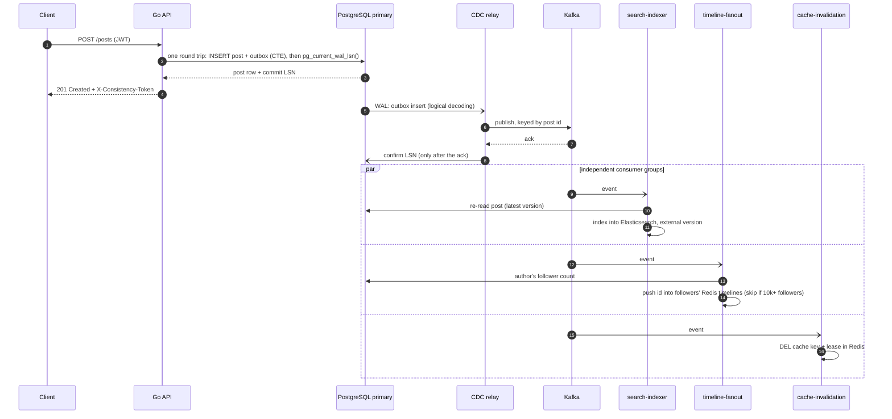
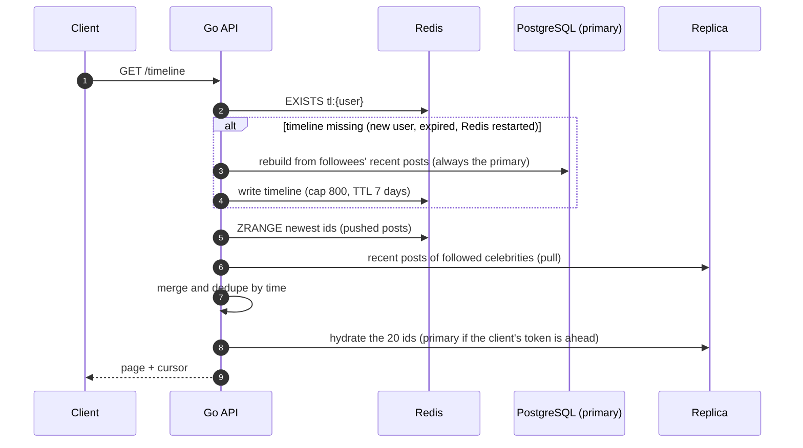
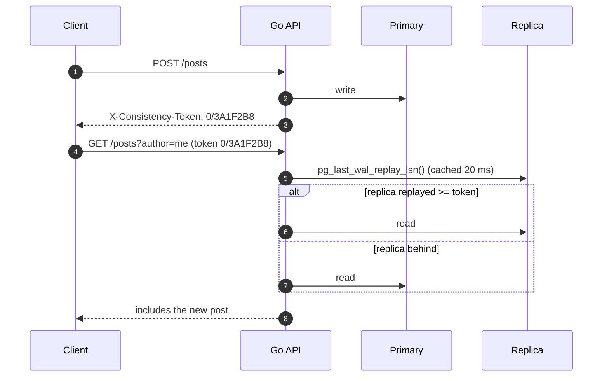
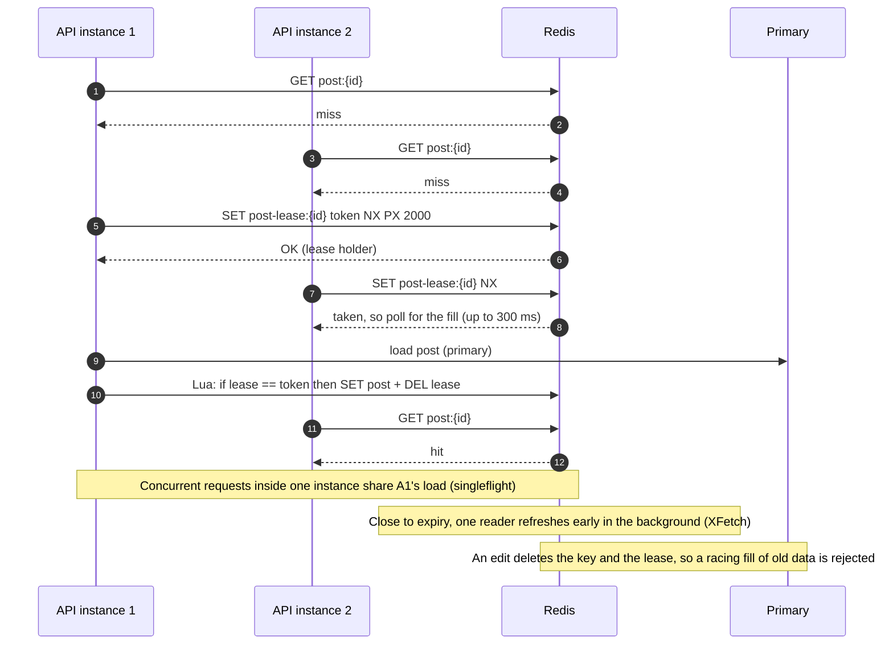
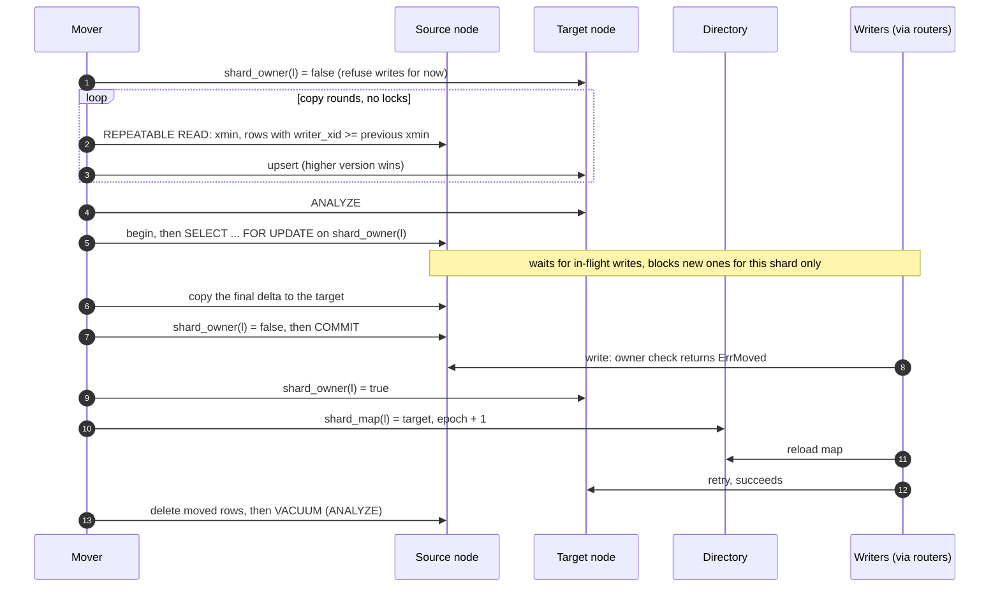
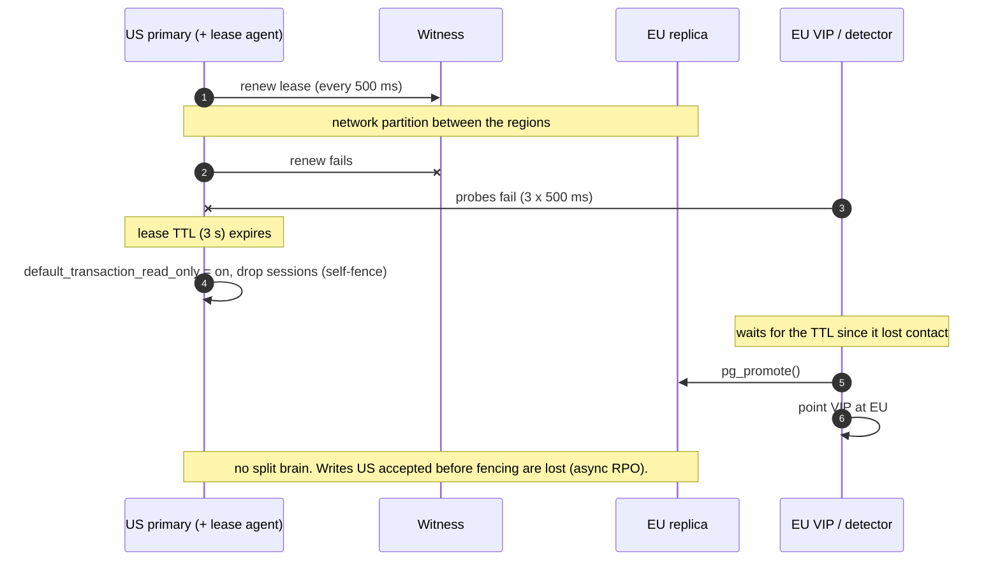

# Request and data flows

Sequence diagrams for the paths interviewers ask about most. GitHub
renders them; elsewhere, paste them into any Mermaid viewer.

- [1. Creating a post](#1-creating-a-post)
- [2. Reading the home timeline](#2-reading-the-home-timeline)
- [3. Reading your own write through a replica](#3-reading-your-own-write-through-a-replica)
- [4. Reading a hot post through the cache](#4-reading-a-hot-post-through-the-cache)
- [5. Moving a shard online](#5-moving-a-shard-online)
- [6. Region partition and fenced failover](#6-region-partition-and-fenced-failover)

## 1. Creating a post

One statement writes the post and its outbox event. Everything after the
commit is asynchronous and independent per consumer group.

If any consumer is down, its group simply lags and catches up later. The
write already succeeded.

## 2. Reading the home timeline

## 3. Reading your own write through a replica

Reads without a token, the vast majority, always go to the replica.

## 4. Reading a hot post through the cache

## 5. Moving a shard online

Between the source's commit and the target taking ownership, nobody owns
the shard. Writes for it retry. Two owners are never possible.

## 6. Region partition and fenced failover

