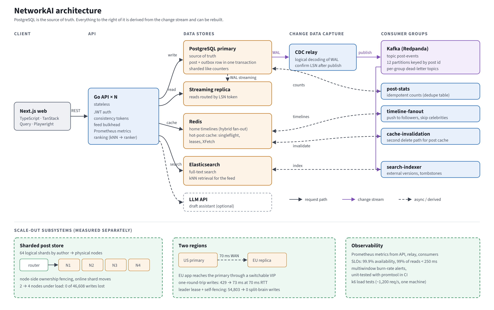

# NetworkAI: high-level overview

## What it is

NetworkAI is a social posting and discovery platform. Users publish text
and media posts, follow each other, read a home timeline, search, like
posts and get a personalized "For you" feed.

- **Stack:** a Go backend, a Next.js/TypeScript frontend, PostgreSQL, Kafka
  (Redpanda), Redis and Elasticsearch, all run with Docker Compose.
- **Engineering focus:** the data path as the system grows. Each failure
  that appears at scale was first reproduced on purpose, then fixed, then
  measured before and after on the same code and data.

How it got here, step by step: [evolution.md](evolution.md).

## Design principles

1. **One source of truth.** PostgreSQL holds all canonical data. Search
   indexes, home timelines, caches and statistics are derived from it and
   can be rebuilt at any time.
2. **No dual writes.**
   - A request writes the change and an outbox row in the same
     transaction.
   - A CDC relay reads committed changes from the write-ahead log and
     publishes them to Kafka.
   - The API never writes to two systems.
3. **Independent, idempotent consumers.**
   - Each downstream job (search indexing, timeline fan-out, cache
     invalidation, statistics) is its own Kafka consumer group, so one
     failing job only delays itself.
   - Delivery is at-least-once, made safe by external versions, dedupe
     tables and naturally repeatable operations.
4. **Scale reads without breaking correctness.**
   - Streaming replicas serve most reads; LSN consistency tokens guarantee
     that users see their own writes.
   - Hybrid fan-out keeps celebrity posts from flooding timelines.
5. **Protect hot spots.** Sharded counters, and a cache protected by
   singleflight, leases and early refresh, absorb traffic on viral posts.
6. **Measure everything.** Every mechanism has a switch, an experiment and
   a before/after number. Reliability is defined by SLOs with burn-rate
   alerts, and the alerts are tested in CI.

## Components

| Component | Role |
|---|---|
| **Next.js web client** | Feed, profiles, search, posting; TanStack Query caching; carries the consistency token; Playwright end-to-end tests |
| **Go API** (stateless, N instances) | REST with JWT auth; routes reads to the replica or primary by token; serves cached posts; bulkhead around the expensive feed |
| **PostgreSQL primary** | Users, posts, follows, likes (sharded counters) and the outbox; the only source of truth |
| **Streaming replica** | Takes staleness-tolerant reads; never used to fill caches |
| **CDC relay** | Logical decoding of the WAL; confirms its position only after Kafka acknowledges, so nothing is lost on a crash |
| **Kafka** (Redpanda) | Topic `post-events`, 12 partitions keyed by post id (per-post ordering); a dead-letter topic per consumer group |
| **Consumer groups** | `search-indexer` → Elasticsearch; `timeline-fanout` → Redis; `cache-invalidation` → Redis; `post-stats` → PostgreSQL |
| **Redis** | Home timelines (sorted sets, capped, expire when unread) and the hot-post cache |
| **Elasticsearch** | Full-text search and kNN retrieval for the personalized feed (retrieval → learned ranker → diversity) |
| **Prometheus** | Metrics from every process; SLO burn-rate and pipeline-lag alerts |

## Two request flows

**Creating a post**
1. The API inserts the post and its outbox event in one transaction, in a
   single network round trip, and returns a consistency token.
2. The relay reads the commit from the WAL and publishes it to Kafka.
3. In parallel and independently:
   - the post is indexed for search;
   - it is pushed to followers' timelines (skipped for authors with
     10k+ followers);
   - its cache entry is invalidated;
   - it is counted.

**Reading the home timeline**
1. Read the user's timeline from Redis. If it is missing, rebuild it from
   the primary.
2. Merge in recent posts from followed celebrities, pulled at read time.
3. Hydrate the post ids from the replica. If the user's token is ahead of
   the replica, hydrate from the primary instead.

## Scale-out work (measured separately)

| Problem at scale | Solution | Result |
|---|---|---|
| A celebrity's fan-out delays everyone's posts | Hybrid push/pull fan-out | 1.28 s → 14 ms behind a 200K-follower author |
| One failing downstream job stalls the others | CDC + Kafka consumer groups | Redis outage: post searchable in 0.73 s (was >60 s) |
| Users miss their own post on a lagging replica | LSN consistency tokens | 31% → 0% violations; 100% of anonymous reads on the replica |
| Cache stampede and stale data on a viral post | Singleflight, leases, XFetch, CDC invalidation | DB queries 1,192/s → 4/s; stale reads 29.5% → 0% (32 instances) |
| Likes contend on one row | 16-way sharded counters | 932 → 3,410 likes/s on one post |
| One database is not enough | 64 logical shards, fenced online moves | 2 → 4 nodes under load: 0 of 46,608 writes lost (naive: 98 lost) |
| Users far from the database | One-round-trip pipelined writes | 429 → 73 ms at 70 ms RTT |
| Region partition with automatic failover | Leader lease + self-fencing | 54,803 → 0 split-brain writes |
| Feed overload takes down search | Bulkhead, payload slimming, query pruning | Search P50 4.4 s → 20 ms at 1,000 req/s |

## Scope

- All experiments ran on a single 4-vCPU machine. Multiple database nodes
  and regions were simulated with containers and a latency proxy, so the
  results show correctness and the cost of each mechanism, not
  throughput scaling across machines.
- The sharded store and the two-region setup are subsystems measured in
  isolation; the API still runs on a single primary with a replica.
- The ranking model was trained and evaluated on synthetic data.

Details: [system-design.md](../docs/system-design.md), the decision records in
[docs/adr/](../docs/adr/), and the `*-experiment.md` files in [docs/](../docs/).
