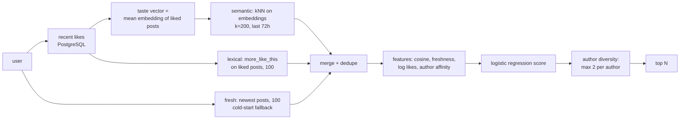

# Personalised feed ("For you")

`GET /feed` returns a ranked list for the logged-in user. Each item includes
its score, the feature values and the retrieval sources that found it, so a
ranking can be explained and debugged.



## Stage 1: candidate retrieval

The goal is recall: find a few hundred plausible posts cheaply, out of
everything recent. There are three sources, queried in parallel:

| Source | Query | Why |
|---|---|---|
| semantic | Elasticsearch approximate kNN (HNSW) on `embedding`, around the user's taste vector | finds posts on topics the user likes, even with different wording |
| lexical | `more_like_this` on the user's recently liked posts | exact term overlap; complements the embedding |
| fresh | newest posts | new users have no taste vector; also gives new topics exposure |

All three exclude the user's own posts, posts they already liked, deleted
posts, and anything older than 72 hours. Filters are applied inside the kNN
search, so all k results satisfy them.

## Stage 2: ranking

The goal is precision: order the candidates. The model is a logistic
regression over standardised features, trained offline. Feature definitions
are shared by `internal/feed.Features` (Go, online) and `build_examples` in
`tools/ranking/train_eval.py` (Python, offline).

| Feature | Definition |
|---|---|
| `cosine` | cosine(taste vector, post embedding) |
| `freshness` | exp(−age_hours / 24) |
| `log_likes` | log(1 + like count) |
| `author_affinity` | log(1 + the user's past likes on this author) |
| `has_history` | 1 if the user has any likes |

After scoring, a diversity pass keeps at most 2 posts per author before
showing anyone's third post. Without it, a burst of near-identical posts from
one author filled the whole feed in testing.

## Embeddings: LSA

The embedding model is TF-IDF (sublinear tf) followed by truncated SVD to 64
dimensions, trained offline on the post corpus. Go reproduces the transform
exactly, which `internal/embed/lsa_test.go` checks against vectors exported
by the Python trainer. The indexer stores the vector in a `dense_vector`
field.

This is classic LSA, not a neural sentence encoder, because the build
environment could not download pretrained models. Everything depends on the
`embed.Embedder` interface, so switching to a neural encoder is a one-file
change plus a `reindex -fresh`.

## Evaluation

See **[ranking-eval.md](ranking-eval.md)** (generated) for the numbers. In
summary:
- the ranker beats the chronological baseline by +14% nDCG@10;
- it closes 31% of the gap to a ceiling that uses hidden variables;
- ablations show `freshness` and `cosine` carry most of the signal.

### The data is synthetic, and this is what that means

No public interaction dataset (MIND, MovieLens and similar) was reachable
from the build environment, so `tools/synth/generate.py` simulates one:
- 20 topics, each with its own vocabulary;
- users with sparse topic interests;
- posts with a hidden quality score;
- likes drawn from a logistic model of interest match, quality and age.

What the evaluation **does** show:
- the pipeline is correct end to end, with no leakage: features use only
  past data, and the split is by time;
- the models recover real signal from observable data only. Rankers never
  read the generator's hidden variables; only the clearly labelled
  reference ceiling does.

What it **does not** show:
- the lift on real users. The generator's like-model has the same shape as
  the ranker's features (topic match, quality, recency), so a gain here is
  an upper bound on what to expect, not a prediction.
- language richness: the synthetic text is keyword soup, so LSA has an easy
  job here.

Before quoting any number outside this repo, re-run the evaluation on a real
dataset. The loader and trainer only need the same three CSV files
(`users.csv`, `posts.csv`, `interactions.csv`).

## Reproduce

```bash
python3 tools/synth/generate.py --out data/synth           # ~15 s
python3 tools/ranking/train_eval.py --data data/synth \
    --models models --report docs/ranking-eval.md          # ~30 s
tools/synth/load.sh data/synth                             # load into PostgreSQL
docker compose run --rm indexer reindex -fresh             # embed + index
```

## Known limitations and next steps

- **Scoring cost is in Elasticsearch.** A `/feed` request runs a kNN and a
  more_like_this query. Under load this is the most expensive endpoint (see
  [benchmark.md](benchmark.md)). Options:
  - cache each user's candidate set for a few minutes;
  - precompute feeds for active users;
  - add Elasticsearch capacity.
- **No impression logging.** Training needs impressions (what was shown and
  not liked) as negative examples. The synthetic data has them, but the API
  does not record them yet. Offline, a like-rate feature built from
  impressions gave +0.5%: small on this data, but logging is still how real
  training data would be collected.
- **No online evaluation.** The next step after offline gains is an A/B test
  on engagement.
