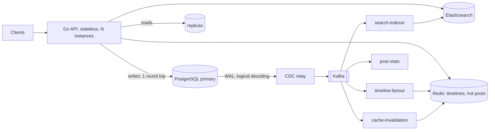

# System design: "Design a news feed", answered with a working system

This is the classic interview question ("design Twitter / Instagram /
a news feed") answered in the usual order:

1. requirements;
2. estimates;
3. API and data model;
4. architecture;
5. deep dives;
6. trade-offs.

The difference from a whiteboard answer: every deep dive links to code
that implements it and an experiment that measured it.

## 1. Requirements

**Functional**

- Post text or media; edit and delete own posts.
- Follow users; home timeline of followed users' posts, newest first.
- Global chronological feed, a personalised "For you" feed, and full-text
  search.
- Like posts, with visible counts.

**Non-functional**

- Reads dominate writes (about 100:1).
- A user sees their own post immediately (read-your-writes). Others may
  see it a few seconds late.
- Search and timelines may lag, but must never lose a post.
- Availability 99.9%, reads under 250 ms for 99% ([slo.md](slo.md)).
- Survive the loss of a dependency (search, cache, broker) and of a
  region.

## 2. Estimates: two sizes, because the answer changes

Assumptions per daily active user (DAU):

- 0.5 posts;
- 10 timeline loads of 20 posts each;
- 20 likes;
- 200 followers on average, power-law distributed (a few accounts have
  millions);
- peak = 3x average.

| | 100k DAU | 10M DAU |
|---|---|---|
| Posts written | 50k/day, **~2/s peak** | 5M/day, **~175/s peak** |
| Timeline loads | 1M/day, ~35/s peak | 100M/day, **~3,500/s peak** |
| Post lookups (hydration, 20 per load) | ~700/s peak | **~70k/s peak** |
| Likes | ~70/s peak | **~7,000/s peak**, concentrated on viral posts |
| Fan-out writes (posts × followers) | 10M/day | **1B/day, ~35k/s peak** |
| New post text (1 KB each) | 50 MB/day | 5 GB/day, ~1.8 TB/year (media separate) |
| Timeline cache (800 ids × ~64 B in a Redis zset) | 5 GB if every user has one | **~500 GB** if every user has one; only active users get one (TTL 7 d) |

What this says before any design:

- **At 100k DAU, one PostgreSQL server does everything.** 700 lookups/s
  is light for an indexed primary key. One machine measured about 1,200
  req/s of mixed traffic ([benchmark.md](benchmark.md)). Sharding, multi-
  region and leases would be over-engineering at this size.
- **At 10M DAU, the problems are specific.** They are not "more traffic"
  in general, but a few hot spots:
  - fan-out volume, dominated by celebrities;
  - hot posts, for both likes and reads;
  - read volume on the primary;
  - one primary's storage and write ceiling;
  - users far from the database.

## 3. API and data model

API: see the table in the [README](../README.md#api). Writes return
`X-Consistency-Token`, and clients send it back on reads.

| Data | Store | Why |
|---|---|---|
| users, posts, follows, likes, outbox | **PostgreSQL** (source of truth) | Transactions, constraints. Every derived store can be rebuilt from it. |
| like counts | PostgreSQL `post_like_counts`, 16 shards per post | exact counts without one hot row |
| home timelines | **Redis** sorted sets, post ids scored by time, capped at 800, TTL 7 d | O(log n) push, range read, rebuildable |
| hot post bodies | Redis, cache-aside with leases | survive stampedes |
| search and embeddings | **Elasticsearch** | full text + kNN; derived and rebuildable (blue/green alias) |
| change stream | **Kafka** (Redpanda) topic `post-events`, 12 partitions keyed by post id | one ordered log, many independent consumers |

Shard key, at 10M DAU: **author id**, hashed into 64 logical shards.

- "Posts by user" and "post by id" each hit one shard. The post id
  carries its shard.
- The global feed is scatter-gather, so it comes from Elasticsearch, not
  from the shards.

## 4. Architecture

Write path for a post:

1. The API inserts the post and an outbox row in one statement (one
   transaction).
2. The relay reads the commit from the WAL and publishes it to Kafka.
3. Each consumer group applies it independently:
   - index it in Elasticsearch;
   - push it into followers' timelines;
   - invalidate the cache;
   - count it.
4. A failing consumer only delays its own group.

Read path for the home timeline:

1. `ZRANGE` the user's Redis timeline.
2. Merge in recent posts from followed celebrities (pulled at read time).
3. Hydrate the ids from the replica, or the primary if the user's token
   is ahead of the replica.

## 5. Deep dives (the follow-up questions)

Each deep dive answers one interviewer question. Each has code, a test
and a measurement behind it.

**"Push or pull? What about celebrities?"**
- *Answer:* hybrid. Regular authors are pushed to followers' timelines;
  authors above 10k followers are pulled at read time.
- *Measured:* with pure push, a celebrity with 200k followers made other
  users' posts wait **1.28 s** behind its fan-out. With hybrid, **14 ms**.
- [ADR 0005](adr/0005-hybrid-fanout-home-timeline.md),
  [experiment](timeline-experiment.md).

**"How do search and timelines stay in sync with the database?"**
- *Answer:* never write to two systems from the request. Use a
  transactional outbox, CDC from the WAL, then Kafka consumer groups.
  Delivery is at-least-once, so consumers are idempotent.
- *Measured:*
  - with Redis down, search kept indexing in **0.73 s**, versus stalled
    for over 60 s with one combined worker;
  - an Elasticsearch outage lost 0 writes.
- [ADR 0001](adr/0001-postgres-source-of-truth-with-outbox.md),
  [0006](adr/0006-cdc-and-consumer-groups.md).

**"Replicas lag. How does a user see their own post?"**
- *Answer:* LSN consistency tokens. A read goes to the replica only if
  the replica has replayed past the user's last write.
- *Measured:* **31% → 0%** violations, and browsing stayed 100% on the
  replica.
- [ADR 0007](adr/0007-read-replicas-consistency-tokens.md).

**"A post goes viral. What breaks?"**
- *Answer:*
  - likes on one row lock → sharded counters;
  - a stampede when the cache entry expires or is invalidated →
    singleflight, leases and XFetch;
  - stale cache after edits → leases, plus invalidation from CDC.
- *Measured:*
  - likes: **932 → 3,410/s**;
  - DB loads with 32 instances: **1,192/s → 4/s**;
  - stale reads: **29.5% → 0%**.
- [ADR 0008](adr/0008-hot-keys-sharded-counters-and-cache-leases.md).

**"The database is full / at its write limit. Now what?"**
- *Answer:* shard by author into 64 logical shards. Move whole logical
  shards between nodes online:
  - copy rounds without locks;
  - a per-shard fence;
  - node-side ownership, so stale routers are redirected.
- *Measured:*
  - 2 → 4 nodes under load: **0 of 46,608 writes lost**, writes to the
    moving shard blocked P50 46 ms;
  - the naive copy-then-flip lost 98.
- [ADR 0009](adr/0009-sharding-and-online-resharding.md).

**"Users are in Europe, the database in the US."**
- *Answer:*
  - serve reads locally;
  - make cross-region writes one round trip;
  - route users to a home region (next step).
- *Measured:* **429 → 73 ms** per post at a 70 ms RTT.
- [ADR 0010](adr/0010-multi-region-home-region-writes-and-failover.md).

**"A region goes down. Do you lose data?"**

| Replication | Split-brain writes | Acknowledged writes lost | Cost |
|---|---|---|---|
| async | 54,803 | thousands | none |
| async + leader lease (fencing) | 0 | writes accepted before the fence | 3 s longer outage |
| sync | 0 | 0 | +72 ms per commit; minority region cannot write |

- *Answer:* choose per data type. Feed data uses async with fencing;
  money would use sync.
- [experiment](multiregion-experiment.md).

**"How do you know it is healthy?"**
- *Answer:* SLOs with multiwindow burn-rate alerts. They page when the
  monthly budget is at risk, not on blips. The alerts themselves are
  unit-tested.
- [slo.md](slo.md).

**"How is the For you feed ranked?"**
- *Answer:* two stages. kNN retrieval on embeddings, then a learned
  ranker, then author diversity.
- *Measured:* nDCG@10 +14% offline, on synthetic data. A bulkhead keeps
  the feed from starving search.
- [ranking.md](ranking.md).

## 6. Trade-offs to bring up before being asked

- **Eventual consistency is a product decision.** Search and timelines lag
  by about a second. The author always sees their own post, via the
  token. Others may not, for that second.
- **At-least-once over exactly-once.** Redelivery is made harmless with
  external versions, idempotent consumers and dedupe tables. That is
  cheaper than distributed transactions.
- **Counters are exact, not approximate.** Exact sharded counters cost
  some write throughput. Batching in Redis would be faster and could lose
  counts on a crash.
- **Scatter-gather does not scale.** Cross-shard views belong in derived
  stores built for them (Elasticsearch, timelines).
- **Not built, and why:**
  - multi-primary writes: needs conflict resolution;
  - a separate feed service: the bulkhead was enough at the measured
    load;
  - consensus-based storage (Spanner, CockroachDB): the real answer to
    RPO 0 with automatic failover, and what this system would move to
    next.

## 7. Which mechanism is needed at which scale

| Mechanism | Needed around | Signal that it is time |
|---|---|---|
| Outbox + async indexing | from day one | any second datastore |
| Read replica + consistency tokens | ~1M DAU | primary CPU dominated by reads |
| Timeline cache, hybrid fan-out | ~1M DAU, or the first celebrity | timeline query latency; fan-out lag |
| CDC + Kafka consumer groups | 3+ downstream jobs | one job's outage delays the others |
| Sharded counters, cache leases | the first viral post | lock waits on one row; DB load spikes on expiry |
| Sharding | ~10M DAU or ~1 TB hot data | write ceiling, vacuum or backup time on one primary |
| Multi-region | users on several continents, or a regional-outage requirement | P99 dominated by RTT; DR requirement |
